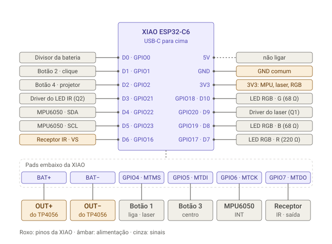
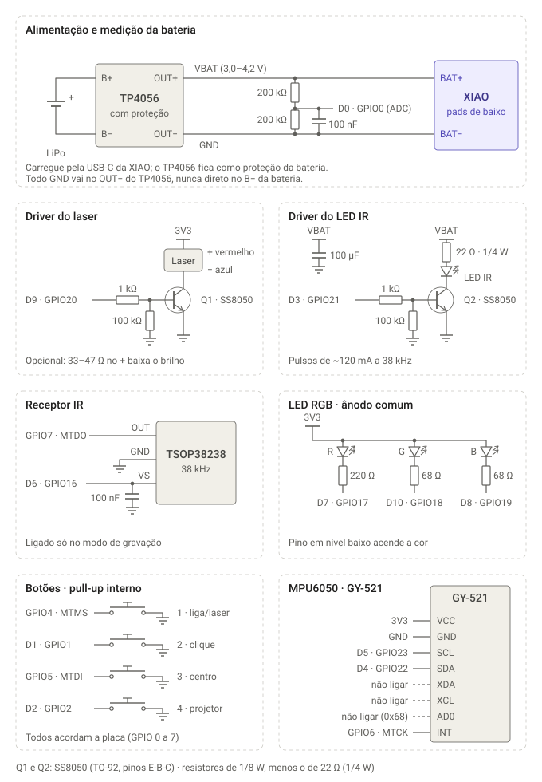

# Esquemático da versão chaveiro (XIAO ESP32-C6)

Ligações de cada componente da [versão chaveiro](CHAVEIRO_C6.md) e a revisão
delas contra as regras da XIAO ESP32-C6. Nada foi montado ainda: a revisão é de
projeto, feita sobre as folhas de dados.

---

## Mapa de pinos

Para onde vai cada pino da XIAO, vista de cima com o USB-C para cima. Os quatro
pads de baixo (GPIO 4 a 7) e os de bateria ficam no verso da placa.

## Circuito de cada componente

---

## Lista de ligações

| Rede | Liga em |
|---|---|
| **VBAT** | TP4056 OUT+ · pad BAT+ da XIAO · 22 Ω do LED IR · 200 kΩ de cima do divisor · + do 100 µF |
| **GND** | TP4056 OUT− · pad BAT− e GND da XIAO · emissores de Q1 e Q2 · os dois 100 kΩ · 200 kΩ de baixo do divisor · os dois 100 nF · − do 100 µF · GND do receptor · GND do MPU · um lado dos 4 botões |
| **3V3** | 3V3 da XIAO · VCC do MPU · + do laser · ânodo comum do LED RGB |
| D0 · GPIO0 | meio do divisor da bateria e 100 nF ao GND |
| D1 · GPIO1 | botão 2 (clique) |
| D2 · GPIO2 | botão 4 (projetor) |
| D3 · GPIO21 | 1 kΩ até a base de Q2 (LED IR) |
| D4 · GPIO22 | SDA do MPU |
| D5 · GPIO23 | SCL do MPU |
| D6 · GPIO16 | VS do receptor IR, com 100 nF ao GND encostado no receptor |
| D7 · GPIO17 | 220 Ω até o cátodo vermelho do LED RGB |
| D8 · GPIO19 | 68 Ω até o cátodo azul |
| D9 · GPIO20 | 1 kΩ até a base de Q1 (laser) |
| D10 · GPIO18 | 68 Ω até o cátodo verde |
| pad MTMS · GPIO4 | botão 1 (liga / laser) |
| pad MTDI · GPIO5 | botão 3 (centro) |
| pad MTCK · GPIO6 | INT do MPU |
| pad MTDO · GPIO7 | OUT do receptor IR |
| Coletor de Q1 | − do laser (fio azul) |
| Coletor de Q2 | cátodo do LED IR |
| 5V da XIAO | **não ligar** (só tem tensão com o USB-C conectado) |
| XDA, XCL, AD0 do GY-521 | **não ligar** (o AD0 já vem puxado para o GND no módulo: endereço 0x68) |

---

## Revisão das ligações

### Conferido

- **Pinos que acordam a placa:** o C6 só acorda do sono profundo pelos GPIO 0 a 7.
  Os quatro botões (GPIO 1, 2, 4, 5) e o INT do MPU (GPIO 6) estão todos nessa
  faixa.
- **Medição da bateria:** o GPIO0 é canal do ADC1. Com o divisor de 200 kΩ +
  200 kΩ, a bateria cheia (4,2 V) chega a 2,1 V no pino, dentro da faixa do ADC.
  O divisor gasta ~10 µA o tempo todo.
- **Pinos de boot (strapping):** no C6 são os GPIO 4, 5, 8, 9 e 15. Os GPIO 4 e
  5 estão com botões, que só mudam alguma coisa se estiverem apertados na hora
  do reset, e mesmo assim só afetam um modo de boot que não usamos. Os GPIO 8, 9
  e 15 ficaram livres.
- **Pinos reservados da XIAO:** nenhum é usado. São o GPIO3 e o GPIO14 (chave da
  antena), o 12 e o 13 (USB), o 15 (LED da placa) e o 9 (botão BOOT).
- **GPIO16 (D6):** é o TX da serial e pisca durante o boot. Por isso ele só
  alimenta o receptor, que não se importa com isso; no laser, ele acenderia o
  laser a cada boot.
- **Correntes nos pinos:** cada cor do LED RGB puxa ~6 mA, a base de cada
  transistor 2,5 mA, e o receptor ~0,4 mA. Tudo bem abaixo do limite do pino.
- **Laser e LED IR desligados no sono:** no sono profundo os pinos de cima do
  GPIO 7 ficam soltos. Os 100 kΩ da base para o GND garantem que Q1 e Q2 fiquem
  desligados.
- **MPU6050:** o GY-521 já tem os resistores de pull-up do I²C e o AD0 puxado
  para o GND, então funciona direto no 3V3.
- **Transistores:** com 2,5 mA na base, o SS8050 conduz totalmente até ~200 mA
  (ganho mínimo de 85). O LED IR usa ~120 mA e o laser ~25 mA.

### Corrigido nesta revisão

1. **100 nF no VS do receptor IR.** Ele é alimentado por um pino, e a folha de
   dados recomenda filtrar a alimentação. Sem o capacitor, o receptor pode pegar
   ruído e gravar o código errado. Entra mais um 100 nF na lista de compras.
2. **Resistor de 22 Ω do LED IR em 1/4 W.** Nos pulsos ele dissipa até ~0,33 W,
   acima do 1/8 W dos outros.
3. **Todo GND no OUT− do TP4056.** A proteção da bateria corta o negativo, então
   qualquer GND ligado direto no B− passa por fora dela.
4. O desenho em texto do [CHAVEIRO_C6.md](CHAVEIRO_C6.md) dizia S8050 em vez de
   **SS8050**.

### Para o firmware

O circuito depende de alguns cuidados no código do C6:

- **GPIO7 sem pull-up enquanto o receptor estiver desligado.** A saída do
  receptor tem pull-up interno até o VS. Se o pino estiver com pull-up e o
  receptor desligado, ele passa a ser alimentado pelo próprio pino e gasta
  dezenas de µA no sono.
- **Pull-ups dos pinos de acordar mantidos no sono profundo** (despertar ext1 por
  nível baixo nos GPIO 1, 2, 4, 5 e 6).
- **INT do MPU como ativo-baixo e dreno aberto**, usando o pull-up do GPIO6.
- **Não iniciar a UART0** (GPIO 16 e 17); o monitor serial usa a USB.
- **Não mexer no GPIO3 nem no GPIO14:** do jeito que vêm, a XIAO usa a antena
  cerâmica da placa.
- **ADC com atenuação de 12 dB** e média de várias leituras para a bateria.

---

## Mantendo os desenhos em dia

Os dois SVG são arquivos de texto: dá para editar no Inkscape ou à mão. Se mudar
algum pino, atualize as duas imagens, a lista acima e a tabela de ligações do
[CHAVEIRO_C6.md](CHAVEIRO_C6.md) juntas.
